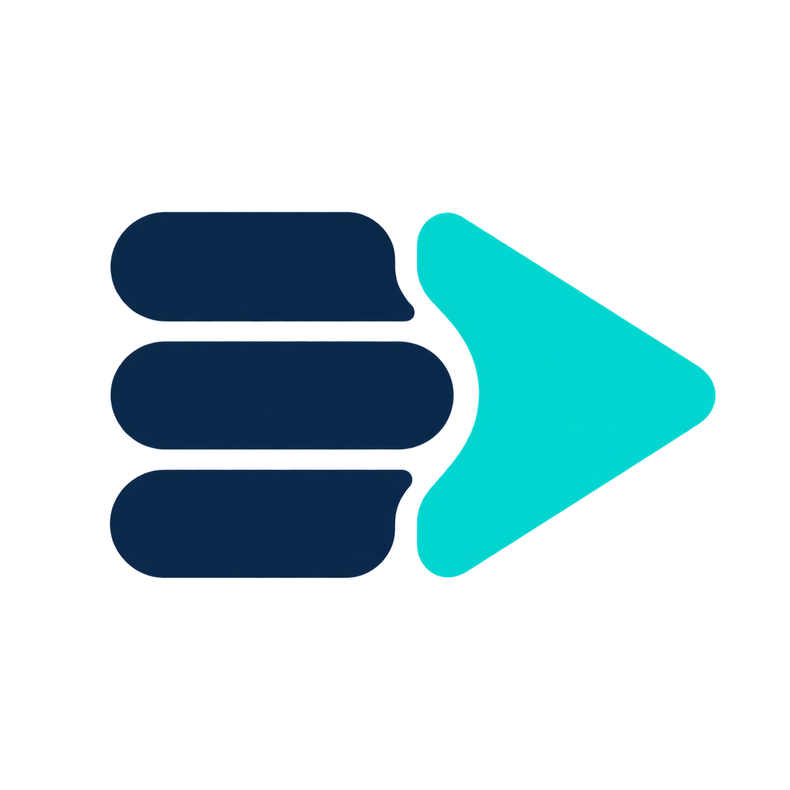
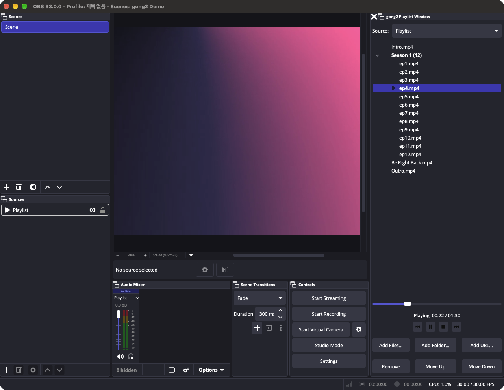
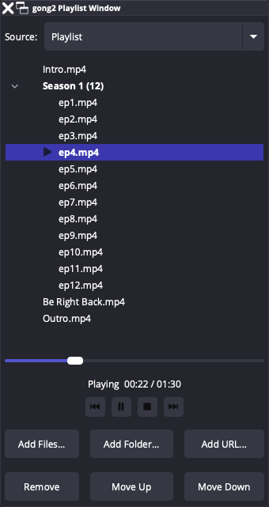

<div align="center">

<sub>[English](README.md) &nbsp;•&nbsp; 🇰🇷 한국어</sub>

<br>
<br>



# gong2 Playlist Source

**VLC 비디오 소스를 대체하는 OBS 재생목록 소스 — VLC 설치가 필요 없습니다.**

OBS 기본 미디어 소스 위에서 동작하므로 하드웨어 디코딩·HDR·속도 조절을 그대로 씁니다.<br>
방송 중에도 목록을 고치고, 재시작 후 이어서 재생하고, 독으로 붙는 재생목록 창에서 모두 조작하세요.


[](buildspec.json)
[](LICENSE)

<br>

<a href="https://github.com/HAEGONG/gong2-playlist-source/releases">
  
</a>
&nbsp;
<a href="https://github.com/HAEGONG/gong2-playlist-source/releases">
  
</a>
&nbsp;
<a href="https://github.com/HAEGONG/gong2-playlist-source/releases">
  
</a>

<sub>[전체 릴리스](https://github.com/HAEGONG/gong2-playlist-source/releases) &nbsp;·&nbsp; macOS: 유니버설 .pkg &nbsp;·&nbsp; Windows: x64 설치 프로그램 또는 .zip &nbsp;·&nbsp; Linux: x86_64 .deb</sub>

<br>
<br>



<br>

[기능](#-기능) &nbsp;•&nbsp; [빠른 시작](#-빠른-시작) &nbsp;•&nbsp; [동작 방식](#-동작-방식) &nbsp;•&nbsp; [소스에서 빌드](#%EF%B8%8F-소스에서-빌드) &nbsp;•&nbsp; [라이선스](#-라이선스)

</div>

---

## ✨ 기능

<table>
<tr>
<td width="50%" valign="top">

### 📂 파일, 폴더, URL

파일 하나, 폴더 통째로, 스트림 URL을 한 목록에 섞어 넣을 수 있습니다. 폴더는 자연 정렬 순으로 재생되어 `ep2`가 `ep10`보다 먼저 나옵니다.

</td>
<td width="50%" valign="top">

### ✏️ 재생 중 편집

항목을 추가·삭제·순서 변경해도 지금 재생 중인 영상은 끊기지 않습니다. 재생 중인 파일이 목록에서 빠지면 같은 위치의 다음 항목을 재생합니다.

</td>
</tr>
<tr>
<td width="50%" valign="top">

### ⏯️ 재시작 후 이어서 재생

OBS를 다시 켜면 종료 시점의 파일과 재생 위치(일시정지 상태 포함)를 복원합니다. 5초마다 `resume.json`에도 위치를 기록하므로 OBS가 갑자기 꺼져도 남습니다.

</td>
<td width="50%" valign="top">

### 🪟 독으로 붙는 재생목록 창

재생 중인 항목을 한눈에 보고, 더블 클릭으로 원하는 영상을 바로 재생하고, Finder에서 파일을 끌어다 놓으세요. 재생 버튼과 탐색 슬라이더도 있습니다. 별도 창으로 띄우거나 메인 창에 붙일 수 있습니다.

<p align="center"></p>

</td>
</tr>
<tr>
<td width="50%" valign="top">

### 🗂️ 폴더 안 파일 하나하나 관리

폴더 안의 파일도 순서를 바꾸거나 빼고, 다시 읽어서 새 파일을 추가할 수 있습니다. *이름순으로 되돌리기*, *삭제한 파일 되돌리기*로 언제든 원래대로 돌립니다. 디스크의 파일은 절대 지워지지 않습니다.

</td>
<td width="50%" valign="top">

### 🎛️ 내부는 미디어 소스

VLC를 설치할 필요가 없습니다. 하드웨어 디코딩·HDR·속도 조절은 OBS 기본 미디어 소스의 기능을 그대로 씁니다.

</td>
</tr>
</table>

**그 밖에:** 🔁 반복 &nbsp;·&nbsp; 🔀 무작위 재생 &nbsp;·&nbsp; 🙈 소스가 숨겨졌을 때 동작(계속 재생 / 일시정지 / 정지) &nbsp;·&nbsp; ⌨️ 단축키(재생·일시정지, 처음부터, 정지, 다음, 이전)

---

## 🚀 빠른 시작

1. [Releases](https://github.com/HAEGONG/gong2-playlist-source/releases)에서 플랫폼에 맞는 파일을 **내려받아 설치**합니다.
2. **OBS를 재시작**합니다.
3. **소스 추가 → gong2 재생목록 소스**로 소스를 만들고 파일이나 폴더를 추가합니다.
4. **도구 → gong2 재생목록 창**(또는 소스 속성의 **재생목록 창 열기**)에서 목록을 관리합니다.

OBS 언어가 영어면 메뉴가 *gong2 Playlist Source*, *gong2 Playlist Window*로 표시됩니다.

> [!NOTE]
> **OBS 33 이상이 필요합니다** (OBS 33.0.0 기준으로 빌드).

> [!TIP]
> **macOS:** 패키지는 공증(notarization)되어 있지 않습니다. macOS가 설치를 막으면 `.pkg` 파일을 오른쪽 클릭 → **열기**를 선택하거나, **시스템 설정 → 개인정보 보호 및 보안**에서 허용하세요.

<details>
<summary><b>🗂️ 재생목록 창의 폴더 동작</b></summary>
<br>

폴더 내용은 폴더를 추가할 때(그리고 OBS를 시작할 때) 읽습니다. 그 뒤로는:

| 동작 | 설명 |
| --- | --- |
| **이 폴더 다시 읽기** | 폴더를 다시 읽습니다. 새 파일은 이름 순으로 맨 뒤에 붙습니다. |
| 드래그 앤 드롭 / **위로** · **아래로** | 폴더 안 파일의 순서를 바꿉니다. |
| **이름순으로 되돌리기** | 원래 이름 순서로 초기화합니다. |
| **Delete** 키 / **삭제** | 재생목록에서만 뺍니다. 디스크의 파일은 지워지지 않습니다. |
| **삭제한 파일 되돌리기** | 뺀 파일을 다시 살립니다. |

</details>

---

## 🧩 동작 방식

1. **재생목록 소스** — [`src/playlist-source.cpp`](src/playlist-source.cpp)가 숨겨진 OBS 미디어 소스를 만들어 항목을 하나씩 넘겨주고, 그 영상과 오디오를 그대로 전달합니다. 재생 순서·반복·무작위·재생 위치를 관리합니다.
2. **재생 위치 저장** — [`src/resume-store.cpp`](src/resume-store.cpp)가 재생 위치를 플러그인 설정 폴더의 `resume.json`에 기록합니다.
3. **재생목록 창** — [`src/playlist-window.cpp`](src/playlist-window.cpp)는 목록을 보여주고 편집하는 Qt 독입니다.
4. **공용 API** — [`src/playlist-source.hpp`](src/playlist-source.hpp)는 소스와 창 사이의 인터페이스입니다.

재생목록은 소스 설정의 `playlist` 항목(OBS 편집 목록 형식)에 저장되므로, 속성 창과 재생목록 창이 항상 같은 데이터를 편집합니다.

---

## 🛠️ 소스에서 빌드

릴리스 패키지는 GitHub Actions로 빌드됩니다([`.github/workflows`](.github/workflows) 참고). macOS에서 로컬로 빌드하려면 Xcode 없이 Command Line Tools, CMake, Ninja만 있으면 됩니다.

```bash
brew install cmake ninja
```

```bash
scripts/build-macos.sh --install
```

빌드가 끝나면 OBS를 재시작하세요.

<details>
<summary><b>로컬 빌드 동작 방식</b></summary>
<br>

- 설치된 `/Applications/OBS.app`의 라이브러리에 직접 링크하고, 헤더는 같은 버전의 obs-studio 소스에서 가져옵니다.
- 처음 실행하면 `.deps/`에 다음을 내려받습니다.
  - obs-studio 소스 (설치된 OBS 버전과 같은 태그)
  - obs-deps의 Qt 6 및 의존성 패키지 (OBS가 함께 배포하는 것과 같은 빌드)
- `--install`은 결과물을 `~/Library/Application Support/obs-studio/plugins/gong2-playlist-source.plugin`에 복사하고, 이전 이름의 `playlist-source.plugin`이 있으면 함께 지웁니다.
- **OBS를 업데이트했다면** `.deps/obs-studio`를 지우고 다시 빌드하세요.
- obs-deps 버전을 바꾸려면 `OBS_DEPS_VERSION` 환경 변수를 설정하세요 (해당 OBS 버전의 `CMakePresets.json` 참고).

</details>

---

## 📄 라이선스

직접 작성한 프로젝트 코드는 [**0BSD**](LICENSE)로 제공합니다. 출처 표기 의무 없이 사용·수정·상업적 이용·재배포할 수 있습니다.

외부 빌드 파일은 기존 라이선스를 유지하며, OBS와 링크한 플러그인을 배포할 때는 GPL 조건을 준수해야 합니다. 자세한 내용은 [THIRD_PARTY_NOTICES.md](THIRD_PARTY_NOTICES.md)를 참고하세요.
