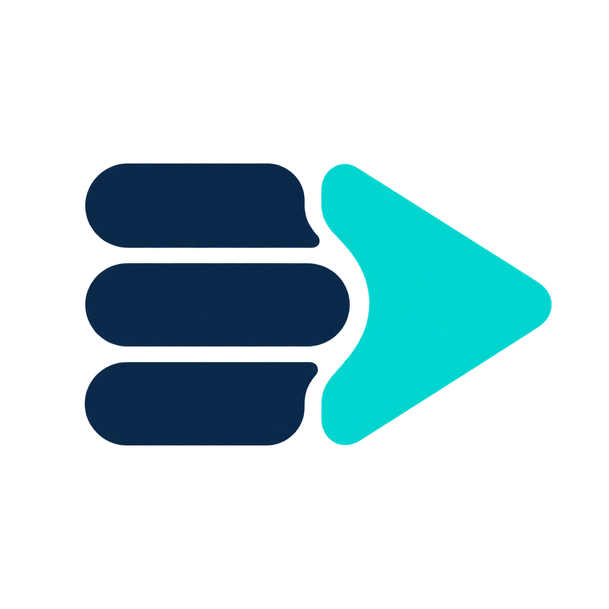

<div align="center">

<sub>English &nbsp;•&nbsp; [🇰🇷 한국어](README.ko.md)</sub>

<br>
<br>



# gong2 Playlist Source

**A playlist source for OBS that replaces the VLC Video Source — no VLC required.**

Built on OBS's own Media Source, so hardware decoding, HDR, and speed control just work.<br>
Edit the list mid-stream, pick up where you left off after a restart, and drive it all from a dockable playlist window.


[](buildspec.json)
[](LICENSE)

<br>

<a href="https://github.com/HAEGONG/gong2-playlist-source/releases">
  
</a>
&nbsp;
<a href="https://github.com/HAEGONG/gong2-playlist-source/releases">
  
</a>
&nbsp;
<a href="https://github.com/HAEGONG/gong2-playlist-source/releases">
  
</a>

<sub>[all releases](https://github.com/HAEGONG/gong2-playlist-source/releases) &nbsp;·&nbsp; macOS: universal .pkg &nbsp;·&nbsp; Windows: x64 installer or .zip &nbsp;·&nbsp; Linux: x86_64 .deb</sub>

<br>

[Features](#-features) &nbsp;•&nbsp; [Quick Start](#-quick-start) &nbsp;•&nbsp; [How It Works](#-how-it-works) &nbsp;•&nbsp; [Build from Source](#%EF%B8%8F-build-from-source) &nbsp;•&nbsp; [License](#-license)

</div>

---

## ✨ Features

<table>
<tr>
<td width="50%" valign="top">

### 📂 Files, folders, and URLs

Mix single files, whole folders, and stream URLs in one list. Folders play in natural name order, so `ep2` comes before `ep10`.

</td>
<td width="50%" valign="top">

### ✏️ Edit while it plays

Add, remove, or reorder items without interrupting the current video. If the playing file is removed, the next item at the same position takes over.

</td>
</tr>
<tr>
<td width="50%" valign="top">

### ⏯️ Resume after restart

The current file and position — paused state included — come back when OBS starts again. The position is also written to `resume.json` every 5 seconds, so it survives a crash.

</td>
<td width="50%" valign="top">

### 🪟 Dockable playlist window

See what's playing, double-click any item to jump to it, and drag in files from Finder. Transport buttons and a seek slider included. Float it or dock it to the main window.

</td>
</tr>
<tr>
<td width="50%" valign="top">

### 🗂️ Per-file folder control

Reorder or remove individual files inside a folder, rescan it to pick up new ones, and undo it all with *Reset to Name Order* or *Restore Removed Files*. Nothing is ever deleted from disk.

</td>
<td width="50%" valign="top">

### 🎛️ Media Source under the hood

No VLC to install. Hardware decoding, HDR, and speed control come straight from OBS's built-in Media Source.

</td>
</tr>
</table>

**Also included:** 🔁 loop &nbsp;·&nbsp; 🔀 shuffle &nbsp;·&nbsp; 🙈 behavior when hidden (keep playing / pause / stop) &nbsp;·&nbsp; ⌨️ hotkeys for Play/Pause, Restart, Stop, Next, Previous

---

## 🚀 Quick Start

1. **Download** the package for your platform from [Releases](https://github.com/HAEGONG/gong2-playlist-source/releases) and install it.
2. **Restart OBS.**
3. **Add Source → gong2 Playlist Source**, then add files or folders.
4. Open **Tools → gong2 Playlist Window** (or **Open Playlist Window** in the source properties) to manage the list.

> [!NOTE]
> **Requires OBS 33 or later** (built against OBS 33.0.0).

> [!TIP]
> **macOS:** The package is not notarized. If macOS blocks it, right-click the `.pkg` and choose **Open**, or allow it in **System Settings → Privacy & Security**.

<details>
<summary><b>🗂️ Folder actions in the playlist window</b></summary>
<br>

A folder's contents are read when you add it (and when OBS starts). After that:

| Action | What it does |
| --- | --- |
| **Rescan This Folder** | Re-reads the folder. New files are added at the end, in name order. |
| Drag and drop / **Move Up** · **Move Down** | Reorders files inside the folder. |
| **Reset to Name Order** | Restores the original name order. |
| **Delete** key / **Remove** | Removes the file from the playlist only — nothing is deleted from disk. |
| **Restore Removed Files** | Brings removed files back. |

</details>

---

## 🧩 How It Works

1. **Playlist source** — [`src/playlist-source.cpp`](src/playlist-source.cpp) creates a hidden OBS Media Source, feeds it one item at a time, and passes its video and audio through. It owns order, loop, shuffle, and position.
2. **Resume store** — [`src/resume-store.cpp`](src/resume-store.cpp) writes the playback position to `resume.json` in the plugin config folder.
3. **Playlist window** — [`src/playlist-window.cpp`](src/playlist-window.cpp) is the Qt dock that shows and edits the list.
4. **Shared API** — [`src/playlist-source.hpp`](src/playlist-source.hpp) is the interface between the source and the window.

The playlist lives in the source's `playlist` setting (OBS editable-list format), so the properties dialog and the playlist window always edit the same data.

---

## 🛠️ Build from Source

Release packages are built by GitHub Actions (see [`.github/workflows`](.github/workflows)). To build locally on macOS — no Xcode, just Command Line Tools, CMake, and Ninja:

```bash
brew install cmake ninja
```

```bash
scripts/build-macos.sh --install
```

Then restart OBS.

<details>
<summary><b>How the local build works</b></summary>
<br>

- It links against the libraries in the installed `/Applications/OBS.app` and takes headers from the obs-studio source of the same version.
- On the first run it downloads into `.deps/`:
  - the obs-studio source, at the same tag as your installed OBS
  - obs-deps' Qt 6 and dependency packages (the same builds OBS ships with)
- `--install` copies the result to `~/Library/Application Support/obs-studio/plugins/gong2-playlist-source.plugin`, and removes the old `playlist-source.plugin` if it is there.
- **After updating OBS**, delete `.deps/obs-studio` and build again.
- To use a different obs-deps version, set `OBS_DEPS_VERSION` (see `CMakePresets.json` for that OBS version).

</details>

---

## 📄 License

The original project code is licensed under [**0BSD**](LICENSE) — use, modify, sell, and redistribute it with no attribution required.

Third-party build files keep their own licenses, and distributing the plugin linked with OBS requires GPL compliance. See [THIRD_PARTY_NOTICES.md](THIRD_PARTY_NOTICES.md).
